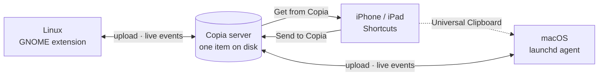

<p align="center">
  <picture>
    <source media="(prefers-color-scheme: dark)" srcset="assets/logo-wordmark-dark.svg">
    
  </picture>
</p>

<p align="center">
  <b>A self-hosted clipboard for Linux, macOS, iPhone and iPad.</b><br>
  Copy on one device and paste on another: text, images and files, through a server you own.
</p>

<p align="center">
  <a href="#quick-start">Quick start</a> ·
  <a href="docs/architecture.md">How it works</a> ·
  <a href="docs/server.md">Server</a> ·
  <a href="docs/linux.md">Linux</a> ·
  <a href="docs/macos.md">macOS</a> ·
  <a href="docs/ios.md">iPhone &amp; iPad</a> ·
  <a href="docs/api.md">API</a> ·
  <a href="docs/security.md">Security</a> ·
  <a href="docs/troubleshooting.md">Troubleshooting</a>
</p>

---

*Copia* is Latin for "abundance" or "supply", and is where the English word *copy* comes from.

Apple's Universal Clipboard is wonderful until one of your computers isn't a Mac. Copia brings the same convenience to a mixed setup: a small server on your own network holds whatever you last copied, and each device keeps it in sync.

## Features

- **Text, images and files.** Copy a paragraph, a screenshot, or a file in your file manager, and paste it anywhere.
- **Live.** Desktops receive new items the instant they're copied, over one long-lived connection, with no polling of the server.
- **One item at a time.** Like a real clipboard: each copy replaces the last, and the old one is deleted from disk.
- **Self-hosted and private.** Runs on your machine, on your network (ideally [Tailscale](https://tailscale.com)), behind a token. Nothing touches a third-party cloud.
- **Polite with secrets.** Skips anything a password manager marks as concealed.
- **No third-party dependencies.** The server uses only Go's standard library, the GNOME extension only libraries GNOME ships, and the Mac agent only Apple's frameworks. Nothing is downloaded at build time.

## Platforms

| Device | Client | Sync |
|---|---|---|
| **Linux** (GNOME 48–50, Wayland) | [GNOME Shell extension](docs/linux.md) | Automatic, both ways |
| **macOS** 12+ | [Background agent](docs/macos.md) (Swift, launchd) | Automatic, both ways |
| **iPhone / iPad** | [Two Shortcuts](docs/ios.md) on Back Tap, the Action Button or Control Center | One tap each way (iOS doesn't allow background clipboard access) |
| **Server** | [Go binary](docs/server.md) on any always-on Linux machine | Holds the current item |

While a Mac is awake and nearby, Apple's Universal Clipboard also carries iPhone copies to the Mac, and the agent forwards them, so many iPhone copies sync with no tap at all.

## How it works



1. You copy something. The client on that device uploads it to the server.
2. The server stores it as the current item, deletes the previous one, and announces it over [Server-Sent Events](docs/api.md#live-events).
3. Every other connected desktop downloads it and puts it on its own clipboard, ready to paste.

Each item carries a content hash, so a device that receives an item never sends it straight back. See [architecture](docs/architecture.md) for the details.

## Quick start

You need an always-on Linux machine for the server (a home server, a VM or a Raspberry Pi), with Go 1.22+ and systemd. Your devices must be able to reach it; Tailscale makes that easy at home and away.

**1. Deploy the server** from a computer that can SSH into it:

```bash
git clone https://github.com/grandmastr/copia.git && cd copia
ssh -t <server> 'sudo loginctl enable-linger "$USER"'   # once: run the service at boot
./server/deploy/deploy.sh <server>
```

The first deploy generates a random token in `~/copia/copia.env` on the server.

**2. Configure each computer.** Copy [`copia.env.example`](copia.env.example) to `~/.config/copia/copia.env`, then fill in your server address and the token from step 1:

```bash
mkdir -p ~/.config/copia
cp copia.env.example ~/.config/copia/copia.env
chmod 600 ~/.config/copia/copia.env
$EDITOR ~/.config/copia/copia.env
```

**3. Install the clients:**

| | |
|---|---|
| Linux | `./gnome-extension/install.sh`, then log out and back in ([guide](docs/linux.md)) |
| macOS | `./mac-agent/install.sh` ([guide](docs/macos.md)) |
| iPhone / iPad | `./ios-shortcuts/build.sh` on a Mac, then AirDrop the two shortcuts ([guide](docs/ios.md)) |

## Limits

| | Default | Setting |
|---|---|---|
| Items kept | 1, kept until replaced | `COPIA_MAX_ITEMS` |
| Largest item | 100 MB | `COPIA_MAX_UPLOAD` |
| Synced automatically up to | 20 MB (larger items are fetched when you ask) | `COPIA_AUTOSYNC_LIMIT` |
| Folders | Not synced yet | |

## Project layout

```
server/            Go server, systemd unit, deploy script
gnome-extension/   GNOME Shell extension (Linux)
mac-agent/         Swift background agent (macOS)
ios-shortcuts/     Shortcut templates + signing script (iPhone/iPad)
assets/            Logo
docs/              Guides and reference
copia.env.example  Client configuration template
```

## Roadmap

- Stream large files instead of holding them in memory
- Sync folders (as a zip)
- A menu bar icon for the Mac agent
- Ready-signed iOS shortcuts that ask for the server and token on import
- An iPhone/iPad keyboard extension with a "Paste from Copia" key that types the current item straight into any text field, with no shortcut to run first (iOS can't update the clipboard in the background, but a keyboard can insert text directly)

## Contributing

Issues and pull requests are welcome. Please keep the project free of third-party dependencies, and see the [docs](docs/) for how each part works.

## License

[MIT](LICENSE) © grandmastr
