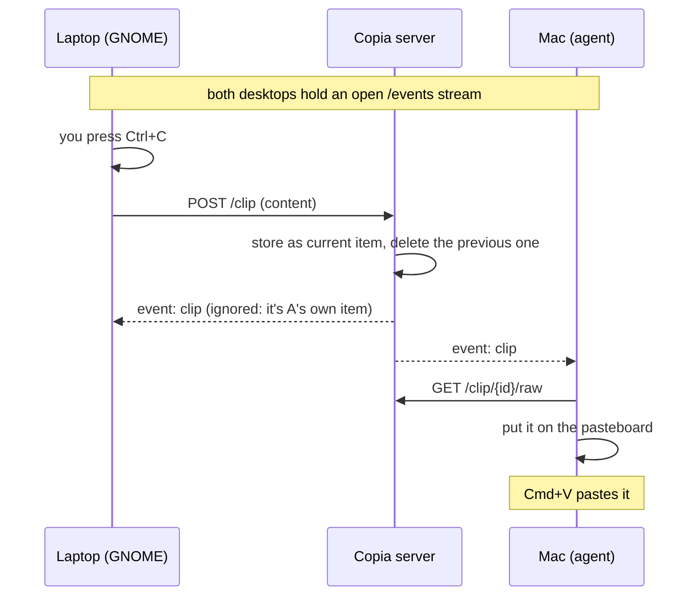

# Architecture

Copia has one server and a thin client on each kind of device. The server is the single source of truth for "what was copied last"; clients mirror it onto their local clipboard and report local copies back.

## Server

- **Storage:** each item is a folder with `meta.json` and one `part-N` file per piece of content. An in-memory index (oldest to newest) is rebuilt from disk at startup.
- **Writes are atomic:** uploads stream to a private staging folder, hashing as they go, and the folder is renamed into place only when complete.
- **Pruning:** after each upload and every 5 minutes, items beyond `COPIA_MAX_ITEMS` or older than `COPIA_MAX_AGE` are deleted. The newest item is always kept. With the default of one item, a new copy replaces the old one immediately.
- **Fan-out:** a hub keeps one buffered channel per `/events` connection. A client that can't keep up is dropped rather than slowing everyone down; it reconnects and resyncs from the `hello` event.
- **No dependencies:** only Go's standard library (`net/http`, `crypto`, `encoding/json`, `archive/zip`, `mime/multipart`).

## Avoiding echo loops

When a client puts a received item on its clipboard, its own clipboard watcher sees a change. Without care, it would upload the item straight back and every device would bounce it around forever. Three layers prevent that:

1. **Clients ignore their own change.** After applying an item, the GNOME extension ignores clipboard changes for a moment; the Mac agent records the pasteboard's change count it caused.
2. **Clients remember what they last sent or applied** (a signature of the text, the image's SHA-256, or the file paths) and skip uploading the same thing again.
3. **The server deduplicates.** Each item's content hash covers its kind and every part's SHA-256, size and name. An upload identical to the current item returns that item with `X-Copia-Duplicate: 1` and announces nothing.

Clients also skip `clip` events whose `device` is their own name.

## Clients

| | Linux | macOS | iOS |
|---|---|---|---|
| Runs as | GNOME Shell extension | launchd agent | Shortcuts |
| Language | JavaScript (GJS) | Swift | Shortcuts actions |
| Notices copies by | GNOME's selection-owner signal | Polling the pasteboard change count (0.5 s) | You tapping *Send* |
| Receives items by | SSE stream | SSE stream | You tapping *Get* |
| HTTP stack | libsoup 3 | URLSession | Shortcuts |
| Received files go to | `~/.cache/copia/<id>/` | `~/Library/Caches/copia/<id>/` | The clipboard |

### Large items

Items over `COPIA_AUTOSYNC_LIMIT` (20 MB) are stored but marked `autoSync: false`. Desktop clients don't download them automatically; on Linux they appear in the menu, where a click fetches them. Uploads over `COPIA_MAX_UPLOAD` (100 MB) are refused by the server, and clients check that limit (sent in `hello`) before reading big files into memory.

### Copied files

- **Linux:** the Files app offers copied files as `text/uri-list` and `x-special/gnome-copied-files`. The extension reads the URIs, uploads the files, and for received files writes `x-special/gnome-copied-files` (`copy` plus file URIs), which the Files app pastes natively.
- **macOS:** file URLs from Finder via `NSPasteboard.readObjects(forClasses: [NSURL])`; received files are written back as `NSURL` objects, which Finder pastes.
- **Several files** travel as one item with several parts; `GET …/raw` returns them as a zip.
